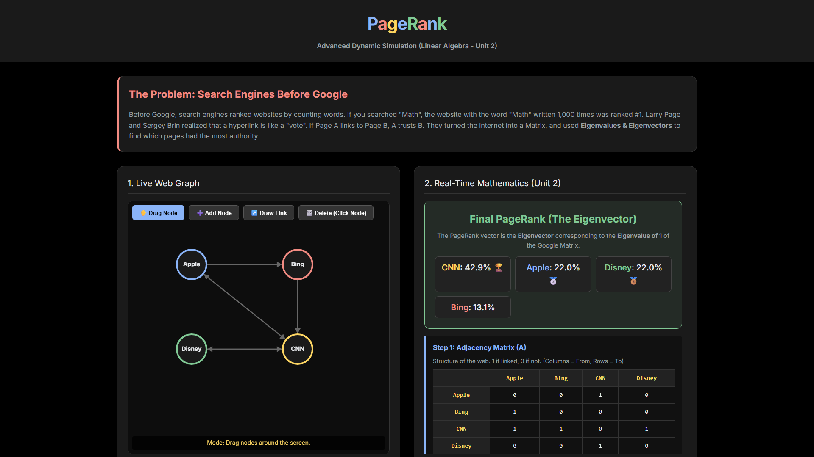
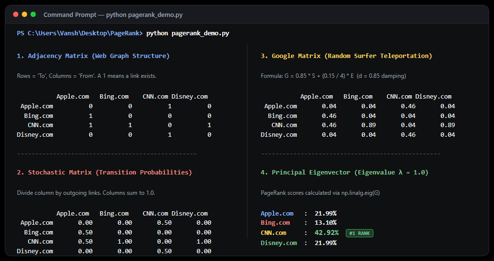

<div align="center">


# GOOGLE PAGERANK
### *Understanding the math behind search: Matrices, Markov Chains & Eigenvectors*

<p align="center">
  <a href="https://www.python.org/"></a>
  <a href="https://numpy.org/"></a>
  <a href="LICENSE"></a>
</p>

<p align="center">
  <a href="#why-pagerank">Why PageRank?</a> •
  <a href="#quick-try">Quick Try</a> •
  <a href="#visual-proofs">Visual Proofs</a> •
  <a href="#the-5-step-math">The Math</a> •
  <a href="#benchmark-results">Benchmark</a> •
  <a href="#how-to-run">How to Run</a> •
  <a href="#project-files">Files</a>
</p>

</div>

---

## Why PageRank?

Back in the late 1990s, early search engines like Yahoo and AltaVista ranked web pages by **counting keywords**. If you typed "running shoes", the engine simply looked for pages that had the phrase "running shoes" repeated the most times.

Naturally, people gamed this within days. Spammers hid the word "shoes" 10,000 times in tiny white font on a white background, instantly jumping to the top of search results. Keyword counting was completely broken.

Larry Page and Sergey Brin tackled this with a smart insight:

> **A hyperlink is a vote of confidence.**  
> If website A links to website B, website A is vouching for website B. But not all votes are equal — a link from **CNN** carries infinitely more weight than a link from an unknown personal blog.

Because important pages give important votes, and you need to know who is important to calculate importance, this creates a **circular dependency**. You cannot solve that with simple counting — but you can solve it cleanly using **Linear Algebra (Markov Chains and Eigenvectors)**.

This project implements that exact mathematics:
1. A **Python numerical script** (`pagerank_demo.py`) that builds each matrix step-by-step and solves for the steady-state eigenvector.
2. A **browser simulator** (`index.html`) where you can drag nodes around, draw links, and watch PageRank update in real time.

---

## Quick Try

Want to test it right now without installing anything?

> [!TIP]
> Just download this repo, unzip it, and **double-click `index.html`** in your browser. It runs locally with zero dependencies (pure HTML5 Canvas and Vanilla JS).

If you want to run the Python math engine:
```bash
git clone https://github.com/Vanshdev3/Google-PageRank.git
cd Google-PageRank
pip install numpy
python pagerank_demo.py
```

---

## Visual Proofs

Both the terminal solver and the interactive web canvas were built to verify the exact same 4-node network benchmark (**CNN**, **Yahoo**, **TechCrunch**, **Amazon**).

### 1. Interactive Canvas Simulator (`index.html`)
Open in any browser to create pages, link them together, and see the matrices update live:

<p align="center">
  
</p>

### 2. Python Terminal Solver (`pagerank_demo.py`)
Computes the analytical eigenvector and confirms it against 32 steps of Power Iteration:

<p align="center">
  
</p>

---

## The 5-Step Math

Here is how the algorithm transforms a raw web of links into an exact ranking vector:

```
[ Web of Hyperlinks ]
         │
         ▼
[ Step 1: Adjacency Matrix (A) ]           ── Raw 1s and 0s (who links to whom)
         │
         ▼
[ Step 2: Stochastic Matrix (S) ]          ── Divide columns by outgoing links (probabilities sum to 1)
         │
         ▼
[ Step 3: Google Matrix (M) ]              ── Add 85% damping factor to fix dead-ends & loops
         │
         ▼
[ Step 4: Eigenvector Solution ]           ── Solve M·v = 1·v for the stationary distribution
         │
         ▼
[ Step 5: Power Iteration Verification ]   ── Multiply repeatedly until v converges (32 iterations)
```

---

### Step 1: The Adjacency Matrix ($A$)
We represent who links to whom as an $N \times N$ matrix.
* **Columns** = Source page (*From*)
* **Rows** = Destination page (*To*)
* A value of `1` means a link exists; `0` means no link.

---

### Step 2: The Stochastic Transition Matrix ($S$)
An adjacency matrix only records connectivity. To turn it into probabilities, we normalize each column by the total number of outgoing links.

If a page has 2 outbound links, a visitor has a **50% chance** of clicking either one. Every column now adds up to exactly $1.0$, turning this into a valid Markov transition matrix.

---

### Step 3: The Google Matrix ($M$) & The Random Surfer
In the real world, two problems break raw Markov matrices:
1. **Dead ends (Rank Sinks):** Pages with no outlinks absorb all the probability mass and cause math to crash.
2. **Spider traps:** Loops of pages linking only to each other trap visitors in an infinite cycle.

To fix this, Google introduced the **Random Surfer Model** with a damping factor $d = 0.85$:
* **85% of the time**, the user clicks a real link on the page.
* **15% of the time**, the user gets bored and jumps to a completely random URL across the web.

$$M = d \cdot S + \frac{1 - d}{N} \cdot E$$

*(where $N$ is total pages and $E$ is an $N \times N$ matrix of all 1s)*

Because every entry in $M$ is strictly positive, the **Perron-Frobenius theorem** guarantees that there is a **unique, dominant eigenvalue equal to 1.0**.

---

### Step 4: Finding the Principal Eigenvector
We find the stationary probability vector $\mathbf{v}$ satisfying:

$$M \mathbf{v} = 1 \cdot \mathbf{v}$$

This vector $\mathbf{v}$ gives the long-term percentage chance that a random surfer ends up on each page. That percentage **is** the PageRank!

---

### Step 5: Power Iteration
In real life, Google cannot invert a matrix with billions of rows. Instead, they use **Power Iteration**: start with an equal guess for all pages ($1/N$) and repeatedly multiply by $M$:

$$\mathbf{v}^{(k+1)} = M \mathbf{v}^{(k)}$$

Because the non-dominant eigenvalues are small ($|\lambda_2| = 0.425$), the error shrinks exponentially. In our 4-node benchmark, it converges to machine precision ($< 10^{-10}$) in **just 32 iterations**.

---

<details>
<summary><b>🔍 Click to expand: Full Matrix Math for the 4-Node Benchmark</b></summary>

<br>

**Our 4-node network:**
* **CNN** links to **Yahoo** and **TechCrunch**
* **Yahoo** links to **CNN**
* **TechCrunch** links to **CNN** and **Amazon**
* **Amazon** links to **CNN**

```text
Adjacency Matrix (A):                 Stochastic Matrix (S):
             CNN  Yahoo   TC   Amz                 CNN  Yahoo   TC   Amz
  CNN         0     1      1    1       CNN       0.00   1.00  0.50  1.00
  Yahoo       1     0      0    0       Yahoo     0.50   0.00  0.00  0.00
  TechCrunch  1     0      0    0       TechCrunch0.50   0.00  0.00  0.00
  Amazon      0     0      1    0       Amazon    0.00   0.00  0.50  0.00

Google Matrix (M) with d = 0.85:
             CNN     Yahoo   TechCrunch  Amazon
  CNN       0.0375  0.8875     0.4625    0.8875
  Yahoo     0.4625  0.0375     0.0375    0.0375
  TechCrunch0.4625  0.0375     0.0375    0.0375
  Amazon    0.0375  0.0375     0.4625    0.0375
```

**Eigenvalues of M:**
* $\lambda_1 = 1.0000$ (The steady state PageRank)
* $\lambda_2 = -0.4250$ (Decays as $(-0.425)^{32} \approx 8 \times 10^{-13}$)
* $\lambda_3 = -0.4250$
* $\lambda_4 = 0.0000$

</details>

---

## Benchmark Results

Here are the final calculated ranks for our 4-node test network:

| Rank | Website | PageRank Score | Why it got this rank |
| :---: | :--- | :---: | :--- |
| **#1** | **CNN** | **42.92%** | Gets inbound links from Yahoo, TechCrunch, and Amazon |
| **#2** | **Yahoo** | **21.99%** | Gets half of CNN's outgoing vote |
| **#3** | **TechCrunch** | **21.99%** | Identical symmetric position to Yahoo |
| **#4** | **Amazon** | **13.10%** | Only receives a single link from TechCrunch |

> **Verification:** The analytical result from `np.linalg.eig` and the numerical result from 32-step Power Iteration match with a difference of only **$0.000000000006$** ($6.36 \times 10^{-12}$).

---

## How to Run

### Method 1: The Interactive Web Simulator (No Installs)
1. Double-click `index.html` to open it in Chrome, Edge, Safari, or Firefox.
2. Click anywhere on the canvas to add pages.
3. Drag from one page to another to create links.
4. Watch the PageRank bars and matrices update in real time.

*(Optional)* You can also run it via a simple Python server:
```bash
python -m http.server 8080
```
Then visit `http://localhost:8080` in your browser.

---

### Method 2: The Python Math Script
1. Make sure you have Python 3 and NumPy installed:
   ```bash
   pip install numpy
   ```
2. Run the script:
   ```bash
   python pagerank_demo.py
   ```
3. Choose an option:
   * Press <kbd>1</kbd> (or hit <kbd>Enter</kbd>): Runs the default 4-node test network and prints all 5 math stages.
   * Press <kbd>2</kbd>: Lets you enter your own custom $N \times N$ link matrix to calculate PageRank for any custom graph.

---

<details>
<summary><b>📥 Want to download the full project as a single ZIP?</b></summary>

<br>

You can download everything in one package:
1. Click the green **Code** button at the top of this GitHub page.
2. Select **Download ZIP**.
3. Extract the folder and you have the complete presentation deck (`PageRank_Pro_Presentation.pptx`), the Python scripts, the notes, and the interactive simulator ready to go!

</details>

---

## Project Files

| File | What it does |
| :--- | :--- |
| **`index.html`** | Interactive visual simulator (HTML5 Canvas + Vanilla JS). Runs anywhere. |
| **`pagerank_demo.py`** | Terminal Python script using NumPy to compute matrices and eigenvectors. |
| **`HOW_TO_RUN.txt`** | Quick-start cheat sheet with terminal commands and options. |
| **`PageRank_Pro_Presentation.pptx`** | 16:9 widescreen presentation slides for project demo. |
| **`Explanation_and_Notes.md`** | Detailed mathematical notes and derivations. |
| **`STUDENT_PRESENTATION_CHEATSHEET.md`** | Oral presentation guide and examiner viva questions. |
| **`LICENSE`** | MIT Open Source License. |

---

<div align="center">
  <sub>Built for Linear Algebra (Eigenvalues & Markov Chains) • Open source under the MIT License</sub>
</div>
